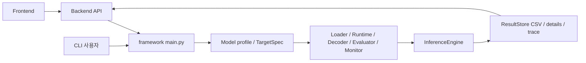

# 01. 전체 구조와 실행 흐름

[목차](README.md) · [다음: 공용 구성 요소 계약](02-component-contracts.md)

## 저장소와 진입점

| 위치 | 실행 시 역할 |
|---|---|
| `framework/src/main.py` | CLI 파싱, 대상·자산 검증, adapter 조립, 실행 및 결과 저장 |
| `framework/src/core/` | 모델·target 정의, 실행 엔진, queue·completion, 결과 저장 |
| `framework/src/dataloader/` · `preprocessor/` | 데이터 읽기와 모델 입력 생성 |
| `framework/src/runtimes/` · `compilers/` · `monitors/` | 장치 호출, artifact 생성, telemetry 수집 |
| `framework/src/decoders/` · `evaluators/` | 장치 출력을 평가 가능한 의미로 변환하고 지표 계산 |
| `backend/app/` | 요청을 CLI subprocess로 실행하고 기본 결과 CSV를 API로 조회 |
| `frontend/src/` | API를 호출하는 React UI. CLI의 모든 옵션을 노출하지는 않음 |

`backend/app/services/benchmark_service.py`는 요청으로 CLI 인자 목록을 만들고
`FRAMEWORK_PYTHON`으로 `main.py`를 실행한다. 웹의 job ID는 subprocess 관리용이며
결과의 `RUN_ID`와 별개다. `backend/app/services/result_service.py`는
`result_store.py`에서 기본 CSV를 읽는다. 모델·target·artifact 경로와 세부 비동기
옵션을 모두 다뤄야 할 때는 CLI가 기준 진입점이다.
[웹과 CLI 연결](11-web-cli-integration.md)은 요청부터 결과 API까지,
[결과 저장과 산출물 수명](09-result-persistence.md)은 CSV 게시와 복구를 추적한다.



## 실행을 지휘하는 core 클래스

이 클래스들은 벤더별 SDK를 구현하는 위치가 아니다. 실행 순서, 요청 수명,
완료 처리와 결과 저장의 공통 규칙을 담당한다.

| 클래스·파일 | 소유하는 책임 | 확장할 때 건드리는 경우 |
|---|---|---|
| [`BenchmarkRunner`](../../framework/src/core/benchmarkrunner.py) | 동기 경로의 warmup → monitor 시작 → `InferenceEngine.run_e2e()` → monitor 종료·요약 | 동기 실행의 공통 lifecycle 자체가 바뀔 때 |
| [`InferenceEngine`](../../framework/src/core/inference_engine.py) | Loader·Runtime·Evaluator·Decoder 의존성 조립, 동기 루프와 비동기 진입점 | 공통 실행 모드·완료 흐름이 바뀔 때 |
| [`InferencePipeline`](../../framework/src/core/inference_pipeline.py) | batch 구성, Runtime 입력 이름 연결, label의 전처리 context 전달 | 모든 Loader에 적용할 입력·label 규칙이 바뀔 때 |
| [`RuntimeExecutor`](../../framework/src/core/runtime_executor.py) | blocking 또는 native callback의 호출·완료·ACK·shutdown 경계 | 공통 executor 계약이 바뀔 때. 보통 새 벤더는 Runtime hook을 구현 |
| [`AsyncInferenceEngine`](../../framework/src/core/async_inference/engine.py) | bounded 요청 큐, worker, backpressure, timeout·drain lifecycle | 비동기 스케줄링 정책 자체가 바뀔 때 |
| [`CompletionCoordinator`](../../framework/src/core/async_inference/completion.py) | 요청 terminal 기록, decoder·evaluator 호출, 완료 handoff·trace | 모든 모드의 완료·평가 계약이 바뀔 때 |
| [`result_store.py`](../../framework/src/core/result_store.py) | `RUN_ID`, CSV schema, 비동기 reservation·details·trace 경로 | 저장 필드나 산출물 연결을 바꿀 때 |

새 NPU·모델은 대개 아래 adapter/factory를 확장한다. 위 core 클래스를
수정해야 한다면 변경이 특정 벤더에만 필요한지 먼저 확인한다.

## 한 실행이 조립되는 순서

`main.py`의 `main()`과 `execute_benchmark()`를 함께 읽는다.
옵션 출처·병합과 factory 호출 지점은
[실행 설정과 조립](07-configuration-and-assembly.md)에서 단계별로 설명한다.

1. `--model` 프로필과 `--target`을 해석한다. target은 Runtime, 선택적 Compiler,
   Monitor, artifact 형식·장치·capability를 묶는다. `--target`이 있으면 레거시
   `--backend`/`--device`보다 우선한다.
2. target·태스크·CLI 옵션과 필요한 자산을 검사한다. 프로필의 준비 스크립트가
   허용된 경로에서는 모델·데이터를 준비할 수 있다. 사전 컴파일 NPU artifact는
   해당 target의 형식과 경로를 별도로 검증한다.
3. `create_model_spec()`으로 `Model_Spec`을 만든다. ONNX를 읽는 경로에서는
   `__auto__` 이름을 그래프 I/O 이름에 바인딩한다. 컴파일 경로라면
   `Compiler.compile(spec, output_dir)`의 결과를 정규화한다.
4. 벤더별 입력 profile·tensor 계약을 적용한 뒤 `CompiledModel`을 만든다.
   `create_dataloader()`, `create_runtime()`, `create_evaluator()`,
   `create_decoder()`와 선택적 `create_hw_monitor()`를 호출한다. 특정 모델·
   artifact의 전처리나 출력 ABI에 필요한 선택·검증도 이 조립 구간에 있다.
5. `runtime.load(compiled_model)` 후 warmup을 실행한다. 동기 `e2e`는
   `BenchmarkRunner`가 `InferenceEngine.run_e2e()`를 호출한다. `async_queue`는
   `main.py`가 `InferenceEngine.run_async()`를 직접 호출한다.
6. 동기는 지표를 CSV에 저장하고 `RUN_ID`를 출력한다. 비동기는 실행 예약 뒤
   품질 패스(가능한 경우)와 성능 패스를 실행하고, CSV·상세 JSON·선택적
   JSONL trace를 저장한다. 요청이 남아 있으면 안전하게 unload할 수 없다.

`CompiledModel`의 `artifact_path`는 실제 파일의 존재를 확인한다. 다만
`Model_Spec.output_shapes`는 모델 profile의 기대 형식이며, 컴파일된 장치
artifact의 물리적 출력 이름·shape·dtype을 보증하지 않는다. 실제 출력은
artifact metadata와 Runtime 반환값으로 확인하고 올바른 decoder에 연결한다.

## sample에서 결과까지

`DataLoader.load_batch(batch_size)`가 `input`과 `label`을 공급한다. 보통 단일
sample 딕셔너리의 목록이며, `get_metadata()["is_static_batched"]`가 참인
loader는 이미 batch 형태를 반환한다. `InferencePipeline`이 일반 목록의
`input`을 stack하고, 다중 입력 딕셔너리는 입력 이름별로 stack한다. 단일
입력 배열은 모델 입력 이름의 딕셔너리로 감싼다.

```text
Loader sample(s): {"input": ndarray | {name: ndarray}, "label": ..., ...}
  → InferencePipeline.collate_batch / prepare_runtime_input
  → RuntimeExecutor.execute → Runtime.run 또는 Runtime.generate
  → Runtime 출력 딕셔너리 → 선택적 Decoder.decode
  → Evaluator.add_batch(outputs, labels, timing_ms) → Evaluator.compute()
  → ResultStore CSV, 비동기라면 details/trace
```

`preprocess_context`가 sample에 있으면 `InferencePipeline.prepare_eval_labels()`가
label과 함께 evaluator에 전달한다. 좌표 복원이 필요한 비전 태스크가 이 정보를
사용한다. Decoder는 raw head·NMS 출력 등 artifact별 차이를 evaluator가 이해하는
형식으로 변환한다. Decoder가 필요 없는 태스크에서는 `create_decoder()`가
`None`을 반환한다. 실제 호출은
[`CompletionCoordinator`](../../framework/src/core/async_inference/completion.py)에서
`decoder.decode()` 다음 `evaluator.add_batch()` 순서다.

## 동기·비동기 책임 경계

| 경로 | 실행·완료 방식 | 평가 |
|---|---|---|
| `e2e` | inline 반복. `BenchmarkRunner`는 warmup·monitor를 감싸고 `InferenceEngine`이 완료 처리를 수행 | batch별 `add_batch()` 뒤 한 번 `compute()` |
| `async_queue` 품질·런타임 | bounded framework queue, worker, 완료 기록. 품질 패스를 먼저 돌린 뒤 성능 패스를 분리 | 품질 패스에서 evaluator 사용; 성능 패스는 Runtime 완료 처리량 측정 |
| `async_queue --async-pass runtime-only` | 성능 패스만 실행 | decoder·evaluator 생략, `quality_status=skipped` |

target에 `native_async` capability가 있고 Runtime이 필요한 hook을 제공하면
`NativeAsyncRuntimeExecutor`가 SDK callback을 framework 완료 흐름으로 옮긴다.
그렇지 않은 경로의 기본 executor는 blocking `run()`/`generate()`를 호출한다.
framework queue, SDK queue, worker 수는 서로 다른 개념이다.
요청의 등록부터 completion ACK까지는
[비동기 실행 내부 구조](08-async-internals.md)에 순서대로 정리했다.

**`e2e`는 실행 모드 이름이다.** 저장된 동기 latency가 loader·decoder·evaluator를
합한 System E2E wall time이라는 뜻은 아니다. 비동기 완료 처리량의 분모와
결과 유효성도 [측정 계약](../../framework/docs/measurement-contract.md)과
[비동기 측정 가이드](../async-inference-queue.md)를 따른다.

## 문제를 추적할 때

| 증상 | 첫 확인 위치 |
|---|---|
| 모델명·target을 찾지 못함 | `core/model_profiles.py`, `core/targets.py`, 세 registry의 entry |
| 자산·컴파일·load 실패 | `main.py`의 자산 검사/compile 구간, `CompiledModel`, 벤더 Runtime `load()` |
| 입력 shape·dtype·layout 불일치 | Loader, 전처리 profile, `InferencePipeline`, artifact metadata |
| 출력 의미·품질 불일치 | Runtime `run()` 반환, `create_decoder()`, decoder, evaluator |
| 비동기 미완료·callback 오류 | `core/runtime_executor.py`, `core/async_inference/`, details JSON/trace |
| 결과 행·API 표시 문제 | `core/result_store.py`, `backend/app/services/result_service.py` |
