# 07. 실행 설정과 구성 요소 조립

[목차](README.md) · [이전: 함수별 구현 참조](06-implementation-reference.md) · [다음: 비동기 실행 내부 구조](08-async-internals.md)

이 장은 `framework/src/main.py`의 한 CLI 실행이 어떤 값으로 각 구성 요소를
만드는지 추적한다. 사용자를 위한 명령 목록은
[실행 방법](../user-guide/03-execution.md), 각 클래스가 구현할 메서드는
[함수별 구현 참조](06-implementation-reference.md)에 있다.
여기의 순서는 `origin/main@30c4db75` 구현을 기준으로 한다.

## 먼저 찾을 함수

| 확인할 단계 | 코드 시작점 | 역할 |
|---|---|---|
| 인자 정의·검증 | [`build_parser()`](../../framework/src/main.py), `validate_async_args()`, `build_async_config()` | CLI 기본값·허용 값과 비동기 시나리오 구성 |
| 모델·target 선택 | [`SUPPORTED_PROFILES`](../../framework/src/core/model_profiles.py), [`resolve_target()`](../../framework/src/core/targets.py) | 모델 task·기본 자산과 Runtime·Compiler·Collector 묶음 선택 |
| 자산·경로 | `run_auto_prepare()`, [`resolve_dataset_paths()`](../../framework/src/utils/dataset_resolver.py) | 준비 스크립트 조건, 이미지·정답 경로 |
| 스펙·컴파일 | `create_model_spec()`, `get_compiler()`, `normalize_compile_result()`, [`CompiledModel`](../../framework/src/core/compiled_model.py) | 원천 모델에서 실행 artifact 경로로 연결 |
| 전처리·입력 계약 | `_build_vision_task_kwargs()`, 벤더 profile resolver, `create_dataloader()` | Loader kwargs와 실제 입력 ABI 선택 |
| Runtime 옵션 | `parse_key_value_options()`, `_merge_runtime_option_layers()`, `_enable_native_async_pipeline()` | target·Loader·CLI 옵션을 검사하며 병합 |
| 객체 생성·실행 | `create_runtime()`, `create_evaluator()`, `create_decoder()`, `create_hw_monitor()`, `execute_benchmark()` | 의존성 조립, `runtime.load()`, 모드별 실행·저장 |

표의 `main.py` 함수들은 같은 [파일](../../framework/src/main.py)에 있다.
벤더 전용 예외가 많으므로 새 경로를 추가할 때는 함수 이름과 함께
`main()`의 **호출 순서**를 확인한다.

```mermaid
flowchart LR
    CLI[CLI 인자] --> P[모델 profile / TargetSpec]
    P --> A[자산 경로와 task 검증]
    A --> S[Model_Spec / 선택적 Compiler]
    S --> C[벤더 입력 profile / CompiledModel]
    C --> L[Loader]
    L --> R[Runtime 옵션 병합 / Runtime]
    R --> D[Evaluator / Decoder / Monitor]
    D --> LOAD[Runtime load]
    LOAD --> RUN[e2e 또는 async_queue]
    RUN --> STORE[CSV / 비동기 details와 trace]
```

## 1. CLI에서 target과 task 확정

`main()`은 `build_parser()`로 인자를 읽고 비동기 옵션을 먼저 검증한다.
`--model`은 필수이며 `SUPPORTED_PROFILES`에 없으면 실행하지 않는다.
task는 프로필의 `task`에서 얻는다. 새로운 CLI 모델명만 추가하고
프로필을 등록하지 않으면 이 단계에서 막힌다.

`resolve_target(args.target, args.backend, args.device)`는 명시된
`--target`을 우선한다. 이 경우 `args.backend`와 `args.device`를
`TargetSpec.runtime_name`·`device`로 바꾼다. `--target`이 없으면
레거시 `--backend`·`--device` 조합으로 target을 찾는다.
일부 target에는 기본 device·layout 보정이 있으므로 CLI에서 layout을
명시했는지도 `_layout_was_explicit`으로 구분한다. 예를 들어 Hailo의
기본 layout은 NHWC로 보정되지만 명시한 layout은 그대로 둔다.

선택한 target은 Runtime뿐 아니라 선택적 Compiler, Monitor,
artifact 형식, device selector와 capability를 함께 정한다.
`--target`을 새로 추가할 때 [target registry](../../framework/src/core/targets.py)만
보지 말고 아래의 자산·입력·출력 조립 분기가 그 조합을 처리하는지도 확인한다.

## 2. 기본 경로, artifact와 dataset 결정

CLI 경로가 빠졌으면 모델 profile의 `default_onnx_path` 또는
`default_model_path`, `default_dataset_path`를 사용한다.
생성형 모델은 `--model-path`와 tokenizer 경로를 별도로 해석한다.
그 후 `run_auto_prepare()`가 허용된 profile의 준비 스크립트를
필요할 때 실행한다. 사전 컴파일 NPU artifact는 자동 모델 준비 대상이
아닐 수 있으므로 해당 target에서 요구하는 경로를 먼저 확인한다.

| 경로 종류 | 주 입력 | 조립에서 확인할 것 |
|---|---|---|
| ONNX 직접 실행·컴파일 | `--onnx` 또는 profile 기본 ONNX | 파일/디렉터리와 `model.onnx` 해석, ONNX I/O sniff 여부 |
| compiler 없는 native target | `--artifact`; Hailo는 `--hef` 또는 `--artifact` | 실행 형식의 사전 컴파일 파일이 있어야 한다. target별 추가 검증은 Runtime이 수행 |
| compiler target의 `--no-compile` | target 형식의 `--artifact` | 컴파일은 건너뛰며 native artifact가 필요하다. 별도 ONNX가 있으면 `Model_Spec`용 I/O를 sniff할 수 있다 |
| 생성형·디렉터리 모델 | `--model-path`, 필요하면 `--tokenizer-path` | target별 로컬 경로·모델 형식·task 검증. Furiosa LLM의 `--fxb`는 별도 선택 경로 |

`resolve_dataset_paths()`는 task와 `--dataset`, `--image-dir`,
`--label-dir`을 Loader용 경로로 바꾼다. 탐지·pose·segmentation은
annotation 경로가 Evaluator 선택에도 영향을 준다. 데이터 준비 스크립트가
끝났더라도 요청한 dataset 경로가 없으면 실패한다.

`main.py`의 `source_artifact_path`와 최종
`CompiledModel.artifact_path`는 다른 값일 수 있다. ONNX sniff는 원천
ONNX를 실제로 읽는 분기에서만 한다. native artifact의 물리 I/O ABI는
이때 확인됐다고 간주하지 않는다.

## 3. 컴파일 결과와 벤더 입력 profile 적용

`--compile-option key=value`는 `parse_key_value_options()`가 문자열
딕셔너리로 만든다. `compile_options = {**target.compiler_options,
**cli_compile_options}`이므로 같은 key의 CLI 값이 target 기본값을 덮는다.
각 Compiler가 받은 문자열을 필요한 타입으로 해석·검증해야 한다.
`target.compiler_name`이 있고 compile이 켜져 있으면 `get_compiler()`,
`Compiler.compile(spec, output_dir)`, `normalize_compile_result()` 순서다.
출력 디렉터리는 **현재 작업 디렉터리 기준**
`artifacts/<target_id>/`이며 Compiler가 돌려준 경로가 최종
`artifact_path`가 된다. compile metadata 중 `compiler_name`과
`artifact_format`은 결과의 target metadata에 반영된다.

컴파일 뒤에 벤더별 profile을 적용하는 분기가 있다. 예를 들어 Mobilint
vision과 Regulus Pose는 **최종 artifact 경로와 CLI 전처리 설정**으로
profile을 찾고, `apply_mobilint_vision_profile()` 또는
`apply_regulus_pose_profile()`로 `Model_Spec`과 layout을 조정한다.
Mobilint BERT류는 별도의 tensor contract·입력 transform을 구성한다.
새 native artifact에서 입출력이 원천 ONNX와 다르면 이와 같은 실제
artifact용 계약을 연결한다. `Model_Spec`의 원천 I/O만으로 Runtime
출력 decoder를 고르지 않는다.

마지막으로 `CompiledModel(spec, backend_name, artifact_path)`을 만든다.
이 객체는 지정 경로의 **존재**를 확인한다. 실제 장치 호환성,
input/output ABI와 SDK 상태는 Runtime의 `load()`에서 검증한다.
경로를 전달하지 않는 일부 생성 모델 경로는 `artifact_path=None`일 수 있다.

## 4. Loader kwargs와 factory 선택

`resolve_dataset_paths()`의 반환 경로와 `_build_vision_task_kwargs()`가
`loader_kwargs`의 시작점이다. 이후 task별 tokenizer·CSV·cache 경로와
벤더별 옵션을 추가한다. DEEPX·Hailo는 artifact 경로와 전처리 모드를,
Mobilint·Regulus는 해석한 profile을 Loader에 넘기는 분기가 있다.
`create_dataloader(spec, dataset_path=args.dataset, layout=args.layout,
**loader_kwargs)`가 실제 구현체를 고른다.

Factory는 task 외에 `backend`, `target_id`, 모델명을 검사한다.
새 Loader 클래스를 추가했지만 선택되지 않는다면
[factory](../../framework/src/dataloader/__init__.py)와
`main.py`의 kwargs 조립을 함께 확인한다.
`_validate_dataloader_samples()`는 Loader의 `total_samples` 속성이
정확히 정수 0인 경우를 조기에 거부한다. 모든 sample의 입력 shape나
정답 정렬까지 검사하는 함수는 아니다.

`--async-preload-inputs`는 비동기 측정 전에 Loader의 일부 sample을
메모리 매핑 파일로 준비하고 wrapper Loader로 교체한다.
Runtime 옵션에 쓰이는 metadata도 교체된 Loader에서 다시 읽는다.
이 경로에 새 Loader를 연결한다면 `load_by_index()`의 안정적인
절대 index 접근이 필요하다.

## 5. Runtime 옵션의 실제 병합 순서

`--runtime-option key=value`는 CLI에서 bool, `None`, 정수, 실수로
해석 가능한 값을 변환한다. 같은 key를 여러 번 주면 마지막 값이 남는다.
이는 Compiler 옵션의 문자열 파싱과 다르다.
Runtime kwargs는 다음 순서로 조립된다.

| 순서 | 옵션 출처 | 적용·검사 |
|---|---|---|
| 1 | `TargetSpec.runtime_options` | 선택한 target의 기본값 |
| 2 | 일부 CLI 전용 인자와 모델 profile | vLLM 모델 길이·메모리 설정, Hailo batch size 등 해당 backend 분기 |
| 3 | `loader.get_metadata()["runtime_options"]`와 선택적 Mobilint tensor contract | 실제 Loader·artifact 입력 계약. 뒤의 값이 같은 key를 바꿀 수 있지만 보호된 ABI key는 CLI에서 임의로 바꿀 수 없음 |
| 4 | Hailo task별 기본 출력 형식 | 분류·탐지에서 CLI가 `output_format_type`을 명시하지 않았으면 적용 |
| 5 | CLI `--runtime-option` | 일반 key는 앞 값을 덮는다. target에 고정된 장치 선택이나 보호된 Pose/Mobilint ABI key는 충돌 시 거부 |
| 6 | 일부 target 후처리와 native async 설정 | TTM-R2 adapter ID, 조건부 `async_pipeline_enabled`·`max_async_inflight` 등을 추가 |

3~5단계는 `_merge_runtime_option_layers()`가 담당한다. 이는 단순한
`dict.update()` 규칙이 아니다. `_merge_target_runtime_options()`는
Mobilint·RBLN의 고정 장치 옵션이 Monitor selector와 일치하는지
확인하고 다른 값으로 덮으려 하면 오류를 낸다. Pose·Mobilint의
artifact ABI를 표현하는 일부 key도 CLI override를 거부한다.
같은 key의 값이 같더라도 type·대소문자 검사를 통과해야 하는 경우가 있다.

그 뒤 `create_runtime(args.backend, device=args.device, **runtime_kwargs)`를
호출한다. 새 Runtime 옵션을 추가한다면 **target 기본값 → Loader metadata
→ CLI 파서 → 보호 규칙 → Runtime 생성자**를 모두 추적한다.
Monitor 생성자는 `TargetSpec.monitor_options`를 별도로 받는다.
Runtime CLI 옵션이 Monitor의 장치 선택까지 자동 변경하지 않는다.

## 6. Evaluator·Decoder·Monitor와 모드 선택

`async_queue --async-pass runtime-only`이면 `evaluator=None`과
`decoder=None`으로 두고 품질 평가 객체를 만들지 않는다.
그 외에는 `create_evaluator()`와 `create_decoder()`가 task, backend,
annotation, Runtime 옵션 및 벤더 profile을 받아 구현체를 고른다.
Decoder 검증은 `runtime.load()`보다 먼저 진행한다.
새 출력 ABI용 Decoder를 추가할 때는 Runtime 반환뿐 아니라
`decoder_runtime_options`에 실제 ABI 선택값이 전달되는지도 확인한다.
비동기에서는 `debug_tensors`를 Decoder 옵션에서 제거한다.

`--monitor`가 있을 때만 `create_hw_monitor()`를 호출한다.
Collector 이름과 옵션은 선택한 target의 `monitor_names`·
`monitor_options`에서 온다. Monitor 객체는 Runtime load 전에 만들고,
load 후의 메모리 스냅샷을 기록할 수 있다. 측정용 polling은
warmup 뒤에 시작한다. 수집 불가 Collector는 생성 과정에서 건너뛸
수 있으므로 Monitor 생성만으로 해당 지표의 존재를 보증하지 않는다.

`runtime.load(compiled_model)`이 성공하면 `target_metadata()`로
target·compile 정보를 만들고 `execute_benchmark()`에 모든 객체를
전달한다.

| 모드 | 실행·저장 흐름 |
|---|---|
| 동기 `e2e` | `BenchmarkRunner.run()`이 warmup·Monitor·`InferenceEngine.run_e2e()`를 감싼다. `_result_save_kwargs()`로 저장 인자를 만들고 `save_result()` 후 `RUN_ID`를 출력한다. |
| 비동기 `async_queue` 품질·런타임 | `build_async_config()`, `reserve_run_artifacts()` 후 가능하면 품질 pass를 돌린다. 이어 별도 Runtime 성능 pass를 돌리고 결과·상세 JSON·선택적 trace를 연결한다. |
| 비동기 `runtime-only` | 품질 pass를 건너뛰고 성능 pass만 실행한다. `quality_status=skipped`는 이 선택의 정상 결과다. |

native async target이면 `_build_async_runtime_executor()`가 **Runtime
load 이후**, 각 pass를 시작하기 전에 callback backend의 batch·inflight·
timeout 조건을 검사한다. hook이 현재 모델에서 native 경로를 제공하지
않으면 blocking executor가 쓰일 수 있다. worker 수만 늘려 native
병렬 실행이 검증됐다고 보지 않는다.

동기 경로는 성공 후 Runtime을 unload한다. 비동기는 예약·trace·
미완료 요청·Runtime unload 안전성까지 묶어 완료 또는 실패를
저장한다. 비동기 상태와 파일 간 연결은 [비동기 측정 가이드](../async-inference-queue.md),
시간 지표의 의미는 [측정 계약](../../framework/docs/measurement-contract.md)을
따른다.

## 7. 새 옵션을 추가할 때 수정할 위치

| 옵션의 성격 | 추가·검증할 곳 |
|---|---|
| 모델 자산·기본 dataset | `core/model_profiles.py`와 `main.py`의 기본 경로·자산 검증 |
| 새 장치의 고정값 | `TargetSpec`의 Runtime·Monitor 옵션, 필요한 경우 `_LOCKED_TARGET_OPTIONS` 검사 |
| Loader 전처리 옵션 | CLI parser, `loader_kwargs` 구성, Loader factory·구현, 캐시 key |
| Runtime 실행 옵션 | parser 또는 `--runtime-option`, 병합·보호 규칙, Runtime 생성자·`load()` |
| Compiler 옵션 | `TargetSpec.compiler_options`, `--compile-option` 파싱, Compiler의 타입·cache 검사 |
| 출력 ABI·threshold | 벤더 profile 또는 Runtime 옵션, Decoder factory·구현, 결과 metadata |
| 비동기 부하 옵션 | parser, `validate_async_args()`, `build_async_config()`, executor hook·테스트 |
| 웹에도 노출할 옵션 | [요청 schema](../../backend/app/schemas/benchmark.py), [CLI 명령 생성](../../backend/app/services/benchmark_service.py), frontend form·type |

진단할 때는 **첫 실패 단계**를 본다. 프로필·target을 못 찾으면 등록 정보,
스펙 파싱·컴파일 실패면 원천 경로와 Compiler, Loader 생성 실패면 dataset·
전처리 선택, Runtime 생성 실패면 병합된 옵션과 SDK import,
`runtime.load()` 실패면 artifact·장치·실제 ABI를 확인한다.
`RUN_ID`가 저장됐어도 품질과 비교 가능성은 별도 상태로 판정한다.
