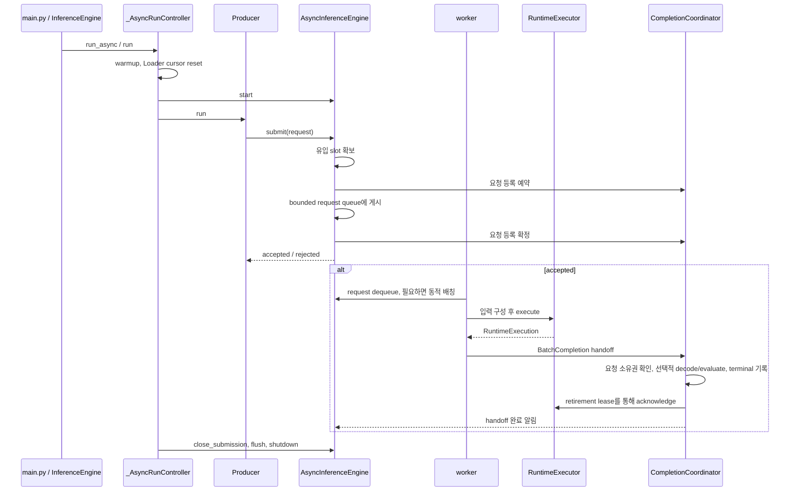

# 08. 비동기 실행 내부 구조

[목차](README.md) · [이전: 실행 설정과 조립](07-configuration-and-assembly.md) · [다음: 결과 저장과 산출물 수명](09-result-persistence.md)

이 장은 `async_queue`에서 요청 하나가 어디로 전달되고, 어느 시점에 완료·자원
반환이 확정되는지 설명한다. 실행 옵션과 지표의 분모·시간 경계는
[비동기 측정 가이드](../async-inference-queue.md), 공통 엔진의 기본 계약은
[core README](../../framework/src/core/README.md)를 따른다.
`_AsyncRunController`와 아래의 queue·handoff 구현은 내부 코드다. 외부 호출자와
벤더 adapter는 [`InferenceEngine`](../../framework/src/core/inference_engine.py)과
[`RuntimeExecutor`](../../framework/src/core/runtime_executor.py)의 계약을 사용한다.

## 요청 한 건이 완료되는 순서

`main.py`의 `execute_benchmark()`가 Runtime과 패스별 executor를 준비한 뒤
`InferenceEngine.run_async()`를 호출한다. 아래 그림은 **한 논리적 요청**의
경로다. worker가 동적 배칭을 하면 여러 요청을 하나의 Runtime 실행과
`BatchCompletion`으로 묶을 수 있다.

1. [`runner.py`](../../framework/src/core/async_inference/runner.py)는
   `offline`이면 `OfflineProducer`, `server_like`이면 `ServerLikeProducer`를
   고른다. [`producers.py`](../../framework/src/core/async_inference/producers.py)는
   Loader에서 sample을 읽어 요청을 발행한다. 워밍업 뒤 Loader cursor를
   되돌린 다음 측정을 시작한다.
2. [`engine.py`](../../framework/src/core/async_inference/engine.py)의
   `submit()`은 유입 slot을 확보하고 요청의 등록·큐 게시를 함께 처리한다.
   수용되지 않은 요청은 거부로 기록된다. framework의 request queue와
   `CompletionCoordinator`의 completion queue는 별도의 bounded 자원이다.
3. `_worker()`는 요청을 꺼내고, 허용된 경우 batch key·크기·대기 시간을
   확인해 동적 배칭한다. `InferencePipeline`이 입력을 구성하고
   `RuntimeExecutor.execute()`가 blocking Runtime 또는 native SDK 결과를
   `RuntimeExecution`으로 돌려준다.
4. [`completion.py`](../../framework/src/core/async_inference/completion.py)는
   등록된 요청인지 확인한다. `QUALITY` 패스에서만 decoder와 evaluator를
   호출한다. 두 패스 모두 terminal 상태와 요청 trace 정보를 기록하며,
   JSONL 파일 저장은 옵션으로 켠 경우에만 수행한다. completion
   handoff가 terminal로 확정되면 retirement lease가 executor에 ACK를
   전달하고, worker·flush 경로가 dequeue와 handoff 소유권을 정리한다.

## 완료와 자원 소유권

| 식별자·자원 | 담당 코드 | 유지·반환 조건 |
|---|---|---|
| `request_id` + `submission_token` | `AsyncInferenceEngine.submit()`, `CompletionCoordinator` | 등록된 제출 시도와 terminal을 연결한다. 알 수 없거나 중복·오래된 completion은 정상 완료로 세지 않는다. |
| 유입 slot과 request queue | `AsyncInferenceEngine` | 수용된 요청의 backpressure를 관리한다. SDK 자체 queue와 독립적이다. |
| completion `operation_key`와 retirement lease | `AsyncInferenceEngine._worker()`, `CompletionCoordinator` | completion handoff의 소유권을 추적한다. terminal commit 뒤 lease가 executor ACK를 요청한다. |
| native `dispatch_token`, 입력 buffer, in-flight permit | `NativeAsyncRuntimeExecutor` | framework ACK와 SDK 작업의 **물리적 완료 증거가 모두** 있어야 dispatch를 제거하고 permit을 반환한다. vendor job ID는 진단용이다. |

native executor의 timeout은 호출자에게 반환하는 **논리적 timeout**이다. SDK
작업이 취소되었다는 뜻이 아니다. 늦은 callback 또는 adapter가 증명한 취소
완료가 오지 않았다면 입력 buffer와 permit은 계속 보유된다.
`shutdown()`은 남은 dispatch를 기다리고, 안전하게 비워지지 않으면 성공을
반환하지 않는다. 이 경우 Runtime unload도 안전하다고 가정하면 안 된다.
패스 종료는 `_AsyncRunController`가 제출을 닫고 `flush()`,
`shutdown()`을 거쳐 판단한다.

## 동작을 바꿀 때 찾을 곳

| 변경 대상 | 주로 볼 코드 | 확인할 테스트 |
|---|---|---|
| 요청 발행 방식·시나리오 | `producers.py`, `runner.py`, `types.py` | `test_async_producers.py`, `test_async_runner.py` |
| admission·queue·worker·동적 배칭·drain | `engine.py` | `test_async_engine.py` |
| native callback·timeout·buffer/permit 반환 | `runtime_executor.py`, 해당 벤더 Runtime | `test_native_async_runtime_executor.py`, `test_async_runtime_boundary.py` |
| terminal·decode/evaluate·trace | `completion.py`, `trace.py` | `test_async_completion.py`, `test_async_trace.py` |
| 패스 조립·측정 집계·결과 연결 | `main.py`, `runner.py`, `metrics.py` | `test_async_two_pass_cli.py`, `test_async_metrics.py`, `test_async_result_artifacts.py` |

지표를 바꾸는 경우에는 [비동기 측정 가이드](../async-inference-queue.md)의
패스·시간 경계와 결과 필드도 함께 확인한다. 벤더 SDK callback을 연결하는
절차는 [NPU 어댑터 확장](04-npu-adapter-extension.md)의 native async 절을
따른다.
