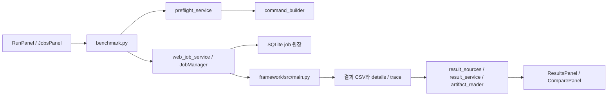

# 11. 웹과 CLI 연결

[목차](README.md) · [이전: 벤더 구현 지도](10-vendor-implementation-map.md) · [다음: 알려진 제약과 유지보수](12-known-limitations.md)

이 장은 `feat/web-cli-parity` 구현 브랜치를 통합한 뒤의 웹 구조를 설명한다.
웹은 프레임워크 엔진을 FastAPI 프로세스에 불러오지 않는다. 서버에 등록된
Python으로 `framework/src/main.py`를 별도 프로세스에서 실행한다.



## 책임과 확장 지점

| 파일 | 책임 | 새 CLI 옵션·결과를 추가할 때 |
|---|---|---|
| [`schemas/benchmark.py`](../../backend/app/schemas/benchmark.py) | 웹 요청의 타입, 범위, 모드별 배타 규칙 | 필드와 검증을 추가한다. `None`은 CLI 인자를 생략한다. |
| [`command_builder.py`](../../backend/app/services/command_builder.py) | typed 요청을 shell 없는 argv 배열로 변환 | `build_parser()`의 옵션과 일대일로 매핑한다. |
| [`runner_profiles.py`](../../backend/app/services/runner_profiles.py) | target·model 조건에 맞는 등록 Python 선택 | 벤더 전용 환경은 서버 설정에 등록한다. 웹 입력으로 실행 파일을 받지 않는다. |
| [`preflight_service.py`](../../backend/app/services/preflight_service.py) | 경로·정적 제약·runner·최종 명령 미리보기 | 실제 SDK·장치 검사를 통과한 것으로 표시하지 않는다. |
| [`job_store.py`](../../backend/app/services/job_store.py) | SQLite 작업 상태와 원본 요청·runner fingerprint 보관 | 성능 수치를 여기에 복사하지 않는다. |
| [`job_manager.py`](../../backend/app/services/job_manager.py), [`process_runner.py`](../../backend/app/services/process_runner.py) | 단일 실행 queue, 작업 취소·timeout, process group, bounded 로그, 재시작 복구 | 종료 코드와 두 run ID, CSV 존재 여부를 분리한다. |
| [`result_sources.py`](../../backend/app/services/result_sources.py), [`result_service.py`](../../backend/app/services/result_service.py), [`artifact_reader.py`](../../backend/app/services/artifact_reader.py) | 허용된 CSV source 등록, 전체 metadata·원본 지표, 상대 경로의 부속 파일 조회 | source ID와 run ID의 쌍을 유지한다. |
| [`webForm.ts`](../../frontend/src/webForm.ts), [`RunPanel.tsx`](../../frontend/src/RunPanel.tsx) | 빈 값을 생략하는 요청 변환, 조건부 실행 폼·preview | 명시 입력과 CLI 기본값을 구분한다. |
| [`JobsPanel.tsx`](../../frontend/src/JobsPanel.tsx), [`ResultsPanel.tsx`](../../frontend/src/ResultsPanel.tsx), [`ComparePanel.tsx`](../../frontend/src/ComparePanel.tsx) | 상태·로그, 원본 결과·부속 파일, 사용자 선택 지표와 조건 표 | 추정 지표·자동 우열 판정을 추가하지 않는다. |

## API 흐름

1. `GET /api/benchmark/catalog`로 profile, target, runner profile을 읽는다.
   target 등록은 실장비·SDK 검증 상태와 다르다.
2. `POST /api/benchmark/preview`에 실행 요청을 보낸다. 응답은 실제 `argv`,
   Python 환경, 결과 CSV, 자산 검사 결과, 정적 오류·경고다. 파일 다운로드나
   NPU 실행은 하지 않는다.
3. `POST /api/benchmark/jobs`는 같은 검사를 다시 수행해 SQLite에 `queued`
   작업을 만든다. 기존 `/api/benchmark/run`도 이 경로로 위임한다.
4. worker는 한 번에 한 작업을 claim하고 새 process group에서 CLI를 실행한다.
   `GET /api/benchmark/jobs`, `/{job_id}`, `/{job_id}/log?offset=&limit=`로
   상태와 로그 일부를 읽고 `/{job_id}/cancel`로 취소한다. timeout과 서버
   재시작은 별도 상태로 남긴다.
5. 종료 시 `RUN_ID_RESERVED`·`RUN_ID`, exit code, 해당 CSV 행의 존재를
   각각 기록한다. exit code 0의 `completed`와 CSV의 `valid`,
   `quality_status=passed`는 서로 다른 판단이다.
6. `GET /api/results/sources` 또는 `POST /api/results/sources`로 결과 CSV를
   선택한다. `GET /api/results?source_id=...`, `/runs/{source_id}/{run_id}`에서
   CSV 내용을 읽고 `/artifacts/details`, `/artifacts/failure_details`,
   `/trace?offset=&limit=`에서 부속 파일을 읽는다. 삭제 API는 CSV 행만 지운다.

## 서버 설정

| 변수 | 기본값 / 의미 |
|---|---|
| `WEB_RUNNERS_FILE` | 등록 Python profile JSON. `profiles`에 `id`, `python`, 선택적 `targets`, `models`, `env`를 둔다. |
| `FRAMEWORK_PYTHON` | 별도 runner 설정이 없을 때 기본 Python. |
| `WEB_ASSET_ROOTS` | 웹에서 지정할 수 있는 모델·데이터 경로의 root 목록. OS 경로 구분자로 나눈다. 기본값은 `framework/`. |
| `WEB_RESULTS_ROOTS` | 결과 CSV의 허용 root 목록. 기본값은 `framework/results/`. |
| `WEB_STATE_DIR` | SQLite와 job 로그의 디렉터리. 기본값은 `framework/results/web/`. |
| `WEB_MAX_QUEUED`, `WEB_MAX_LOG_BYTES` | 대기열과 job 로그 한도. 기본값 10개, 10 MB. |
| `WEB_JOB_RETENTION_DAYS` | 양수로 지정하면 서버 시작 시 그 기간보다 오래된 종료 job과 로그를 지운다. 기본값 0은 자동 정리하지 않는다. 결과 CSV와 부속 파일은 지우지 않는다. |
| `FRONTEND_DIST_DIR`, `CORS_ORIGINS` | 정적 화면 위치와 브라우저 origin. 기본 운용은 loopback이다. |

runner 선택은 target+model 일치, target 일치, 기본 profile 순서다. 실제
SDK별 Python 경로는 운영자가 설정한다. 프론트 개발 서버는 `/api`를
`localhost:8000`으로 proxy한다. 배포 시 `npm run build` 후 다음처럼
worker 1개로 실행한다.

```bash
cd /path/to/ML-HW-Benchmark-Framework/frontend
npm ci
npm run build
cd ../backend
../framework/.venv/bin/python -m uvicorn app.main:app --host 127.0.0.1 --port 8000 --workers 1
```

장비별 Python은 runner profile로 별도 설정한다. 같은 호스트에서 백엔드
worker를 둘 이상 실행하면 단일 실행 규칙을 깨므로 시작 락이 두 번째
worker를 거부한다.

## 새 기능을 연결할 때

1. CLI [`build_parser()`](../../framework/src/main.py)의 option, 기본값,
   명시 여부와 모드별 제약을 확인한다. schema → argv builder → preview →
   `webForm` → 화면을 한 묶음으로 수정한다. 모든 argparse action을
   비교하는 backend 테스트를 함께 갱신한다.
2. 새 결과 필드는 [결과 저장 계약](09-result-persistence.md)과 실제 CSV key를
   먼저 확인한다. `META_COLUMNS`에 속하지 않으면 `metrics`에 남는다.
   이름이 같아도 측정 경계가 다르면 동일 지표로 합치지 않는다.
3. UI는 저장된 원본 key만 수치화한다. 품질·실행·전력 상태와 측정 경계를
   함께 표시한다. CSV에 없는 데이터셋·artifact 정보는 `—`로 두고
   사용 가능한 details를 별도로 확인한다.
4. `backend/tests`의 argv·job·source·부속 파일/API 테스트와 frontend의
   `npm test`, `npm run lint`, `npm run build`를 실행한다. NPU 실장비 검증은
   확인된 모델·artifact·데이터 조합에서 별도로 수행한다.
