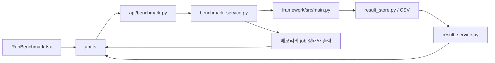

# 11. 웹과 CLI 연결

[목차](README.md) · [이전: 벤더 구현 지도](10-vendor-implementation-map.md)

웹은 framework 엔진을 직접 호출하지 않는다. FastAPI가 실행 요청을 CLI 인자
목록으로 만들고 `framework/src/main.py`를 **별도 프로세스**로 실행한다.
화면의 입력 항목과 결과 표시가 CLI의 모든 기능을 뜻하지 않으므로,
기능을 추가할 때 요청 schema부터 화면까지 연결 지점을 확인한다.

## 실행 요청의 흐름

| 단계 | 읽을 코드 | 실제 역할 |
|---|---|---|
| 입력과 호출 | [`RunBenchmark.tsx`](../../frontend/src/components/RunBenchmark.tsx), [`api.ts`](../../frontend/src/api.ts), [`types.ts`](../../frontend/src/types.ts) | 모델·target 선택, 실행 요청 전송, job 상태 polling·취소 |
| API 검증 | [`api/benchmark.py`](../../backend/app/api/benchmark.py), [`schemas/benchmark.py`](../../backend/app/schemas/benchmark.py) | 프로필·target 목록 조회, 실행 요청 형식과 모델명 검사 |
| CLI 실행 | [`benchmark_service.py`](../../backend/app/services/benchmark_service.py) | `FRAMEWORK_PYTHON`/`FRAMEWORK_DIR` 결정, 인자 조립, subprocess 시작, 출력·종료 코드·timeout·취소 관리 |
| 저장 결과 조회 | [`api/results.py`](../../backend/app/api/results.py), [`result_service.py`](../../backend/app/services/result_service.py), [`schemas/result.py`](../../backend/app/schemas/result.py) | 기본 CSV를 읽어 API 응답으로 변환하고 run ID로 조회·삭제 |
| 화면 표시 | [`App.tsx`](../../frontend/src/App.tsx), `ResultsTable`, `DetailModal`, `CompareChart` | 결과 목록·세부정보·비교 화면 구성 |

`GET /api/benchmark/profiles`는 모델 profile을,
`GET /api/benchmark/targets`는 등록된 target을 반환한다. 목록에 보이는
target이 현재 host의 장치·SDK·artifact 준비까지 보증하지는 않는다.
`POST /api/benchmark/run`은 `job_id`를 돌려주고,
`GET /api/benchmark/jobs/{job_id}`로 작업 상태·출력을 조회한다.
`POST /api/benchmark/jobs/{job_id}/cancel`은 실행 중인 subprocess에 종료를
요청한다. 서버 종료 시에도 진행 중인 subprocess 정리를 시도한다.

## job ID, run ID와 결과 API

`job_id`는 backend가 메모리에서 관리하는 subprocess 작업 ID다. 서버를
재시작하면 이 상태는 유지되지 않는다. `run_id`는 CLI가 CSV 저장에 사용하는
식별자다. backend는 **종료 코드 0인 작업**의 stdout에서 `RUN_ID=<id>`를
읽어 job 상태에 보관한다. CLI가 invalid 결과를 CSV에 남긴 뒤 종료 코드 1을
반환한 경우에는 출력에 `RUN_ID`가 있어도 현재 job 응답의 `run_id`는
채워지지 않을 수 있다. 종료 코드가 0이어도 `RUN_ID` 출력이 없으면 현재
구현은 경고만 남기고 job을 `completed`로 표시한다. 두 ID를 같은 것으로
취급하지 않고 CSV 행까지 확인한다.

`GET /api/results`와 `GET /api/results/{run_id}`는
[기본 CSV](../../framework/src/core/result_store.py)를 읽는다.
CLI가 `--results-path`로 다른 CSV를 사용하면 이 웹 목록에는 나타나지
않는다. 현재 [`_row_to_response()`](../../backend/app/services/result_service.py)는
선택한 메타데이터와 숫자·문자열 metrics를 반환하며,
`async_run_status`·`details_path` 같은 CSV 메타데이터는 API 응답에 싣지
않는다. details·trace 파일을 내려주는 전용 endpoint도 없다.
`DELETE /api/results/{run_id}`는 [결과 저장 장](09-result-persistence.md)에
설명한 대로 CSV 행만 삭제한다.

현재 [`BenchmarkRunRequest`](../../backend/app/schemas/benchmark.py)는
`--inference-mode`·`--scenario`·worker/queue 등의 비동기 CLI 옵션을
전달하지 않는다. 따라서 웹 실행은 CLI 기본 모드인 `e2e`를 사용한다.
비동기 실행과 세부 NPU 옵션이 필요하면 [사용자 실행 가이드](../user-guide/03-execution.md)의
CLI를 사용한다.

## 웹 기능을 추가할 때

1. CLI 옵션과 기본값을 [`main.py`](../../framework/src/main.py)에서 확인하고
   backend `BenchmarkRunRequest`, `start_benchmark()`의 인자 조립, frontend
   `BenchmarkRunRequest` 타입과 입력 화면을 함께 수정한다. backend의
   `job_id`와 CLI `run_id` 연결도 확인한다.
2. 새 결과 필드라면 [결과 저장 장](09-result-persistence.md)의 CSV 경로를
   먼저 확인한다. 웹 노출이 필요할 때 `_row_to_response()`,
   `BenchmarkResultResponse`, frontend `BenchmarkResult`와 화면의
   지표 이름·단위를 맞춘다.
3. [`backend/tests/test_results_api.py`](../../backend/tests/test_results_api.py)의
   결과 변환 테스트와 frontend build를 확인한다. 실행 요청을 바꾼 경우에는
   생성된 CLI 인자, job 상태 전이, 실제 `RUN_ID`와 CSV 행을 소량 실행으로
   대조한다.
