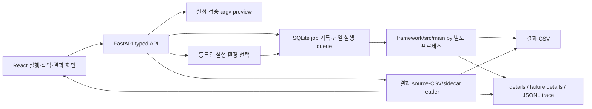

# 웹 실행·결과 시각화 구현 계획

기준: `origin/main@30c4db75`의 `backend/`, `frontend/`, `framework/src/main.py`,
`framework/src/core/result_store.py`. 문서 브랜치 `docs/document-update`에는
이 코드들의 동작 변경이 없다. 2026-10-18 사용자 검토 결정을 반영했다.

## 1. 목표와 완료 조건

NPU가 연결된 **단일 호스트**에서 FastAPI가 프레임워크 CLI를 별도 프로세스로
실행한다. 사용자는 웹에서 현재 CLI의 모델·target·자산·동기/비동기 옵션을
설정하고, 실행 전 명령과 정적 오류를 확인하고, 작업을 시작·취소·조회할 수
있어야 한다. 웹에서 실행한 결과뿐 아니라 등록한 CSV의 결과도 상태, 측정
경계, 품질, 성능, 하드웨어 지표, 비동기 details·trace까지 확인한다.

완료 판정은 다음 다섯 가지를 모두 만족해야 한다.

1. `build_parser()`의 50개 argparse action(논리 설정 49개; `--compile`과
   `--no-compile`은 하나의 설정)을 웹 요청과 CLI argv로 표현한다. 새 CLI
   옵션이 생기면 parity test가 누락을 알린다.
2. 동기 `e2e`, 비동기 `quality-and-runtime`, 비동기 `runtime-only`를
   같은 웹 흐름에서 실행한다. CLI의 기본값과 명시 여부를 보존한다.
3. 작업 재조회, 로그 일부 읽기, 취소, timeout, 서버 재시작 후 상태 확인이
   가능하다. `job_id`, `RUN_ID_RESERVED`, `RUN_ID`, CSV 행의 존재와 유효성
   판정은 별개로 보여준다.
4. 기본 또는 지정 CSV, 정상·실패 details, 선택적 JSONL trace를 웹에서
   열 수 있다. 없는 값은 0이나 추정치로 채우지 않는다.
5. 차트는 선택한 원본 지표의 이름·단위·측정 경계·schema와 각 실행 조건을
   함께 보여준다. 어떤 실행끼리 비교할지는 사용자가 판단한다.

SDK 설치, 모델 컴파일 recipe 작성, 새 NPU adapter 구현, 원격 장비 제어,
공통 System E2E·전력 계측 방식 변경은 이 계획의 범위가 아니다. CLI가
지원하는 기존 자동 자산 준비는 웹 실행에서 그대로 호출될 수 있으므로
실행 전 다운로드/준비 가능성을 표시한다. target 등록은 실장비 검증을
뜻하지 않는다.

## 2. 현재 코드와 차이

| 영역 | 현재 | 필요한 변경 |
|---|---|---|
| 실행 입력 | `BenchmarkRunRequest`는 기본 batch·warmup·HEF·artifact 등 일부만 받는다. `RunBenchmark.tsx`는 일반 artifact 경로조차 입력하지 않는다. | 모델·데이터·토크나이저·사전 컴파일 자산, 전처리, runtime 옵션, 비동기 부하와 결과 경로까지 입력·전달. |
| 실행 환경 | 모든 요청이 하나의 `FRAMEWORK_PYTHON`을 사용한다. 설치 문서에는 NPU SDK 및 일부 모델별 전용 Python 환경이 명시되어 있다. | 호스트에 등록된 실행 환경을 target·model별로 선택하고, 실제 사용한 환경을 job에 기록. |
| CLI 기본값 | 폼이 `layout=NCHW`, `monitor=True`를 항상 보낸다. CLI는 layout을 **명시했는지**로 Hailo 기본 NHWC 보정을 결정하고 monitor 기본값은 False다. | 요청에서 미입력과 명시 입력을 구분. target 선택 시 backend/device 중복 입력을 제거하고 실제 전송 argv를 미리 보여줌. |
| 모델·target 목록 | profile의 `backends`를 task별로 하드코딩하고 target registry는 장치 준비를 검사하지 않는다. | profile·target 정보와 정적 제약을 표시하되 등록/실행 가능/실장비 검증을 별도 상태로 표시. 지원하지 않는 조합을 임의로 성공 가능하다고 표시하지 않음. |
| 작업 수명 | 메모리 dict와 thread에 상태·전체 stdout을 보관한다. 재시작 시 소실되고 취소는 부모 프로세스만 종료할 수 있다. | 영속 job 기록, 한 번에 한 벤치마크 실행, bounded 로그, 프로세스 그룹 취소·timeout, 재시작 복구. |
| 결과 | 기본 CSV만 읽고 `META_COLUMNS` 중 상당수를 버린다. 별도 CSV와 sidecar·trace를 열 수 없다. | 결과 source 관리, 전체 metadata·raw metrics 보존, 상대 경로로 연결된 부속 파일 조회. |
| 시각화 | 정규식으로 지표를 추측하고 평균 지연의 역수로 처리량을 추정할 수 있다. 동기/비동기 상태와 측정 경계를 분리하지 않는다. | 명시적 지표 사전과 모드별 카드·상태 배지·측정 경계, 사용자가 읽을 실행 조건 표. 추정 처리량 제거. |
| 검증 | backend에는 결과 API 테스트 1개 파일만 있고 실행 command/lifecycle 검증은 좁다. frontend에는 build/lint만 있다. | argv parity, 작업 상태·취소·복구, 결과/파일 접근, 화면 상태·선택 지표와 조건 표를 독립 테스트. |

현재 코드 위치: `backend/app/schemas/benchmark.py`,
`backend/app/services/benchmark_service.py`, `backend/app/services/result_service.py`,
`frontend/src/components/RunBenchmark.tsx`, `frontend/src/utils/metrics.ts`,
`frontend/src/components/CompareChart.tsx`. 현재 registry에는 18개 profile 이름
(alias 포함)과 15개 target이 있다. 이 숫자는 하드웨어 검증 조합 수가 아니다.

## 3. 구조 선택

| 접근 | 장점 | 문제 | 결론 |
|---|---|---|---|
| 기존 메모리 job manager와 폼만 확장 | 변경량이 적다. | 재시작·긴 로그·취소·결과 source 연결 문제가 남는다. | 사용하지 않음. |
| **CLI 별도 프로세스 + 영속 job 저장소 + typed API** | 벤더별 Python/SDK 경계를 유지하고 실행·결과 책임을 분리한다. 현재 구조를 확장할 수 있다. | job 상태와 CSV의 동기화 로직이 필요하다. | **채택.** |
| FastAPI 안에서 framework engine 직접 호출 | Python 객체를 직접 공유한다. | 긴 NPU 작업과 SDK lifecycle이 API 프로세스에 결합되고 환경 분리가 어렵다. | 사용하지 않음. |

FastAPI lifespan에서 queue 시작·종료와 재시작 상태 조정을 관리한다. CLI는
등록된 Python 실행 파일과 고정된 `FRAMEWORK_DIR`에서 argv 배열로 실행한다.
명령 문자열을 shell에 전달하지 않는다. 기본 동시 실행 수는 **1**로 둔다.
벤치마크 간 장치·CPU·메모리 간섭을 막기 위한 웹 작업 규칙이며, 웹 밖에서
직접 실행한 CLI까지 통제한다는 뜻은 아니다.

### 같은 호스트의 벤더별 실행 환경

서버 설정 파일의 `runner_profiles`에 `id`, Python 실행 파일의 절대 경로,
필요한 환경 변수, 사용할 target/model 조건을 등록한다. 조건의 우선순위는
`target + model`의 정확한 일치 → `target` → 기본 profile이다. 예를 들어
Furiosa의 모델별 SDK 환경과 다른 NPU 환경을 별도로 등록할 수 있다.
운영자가 등록한 profile만 선택할 수 있고 웹 요청은 실행 파일이나 환경
변수를 임의로 지정하지 못한다. 기존 `FRAMEWORK_PYTHON`은 기본 profile의
호환 설정으로 읽는다. profile의 Python 존재·실행 권한·framework 경로를
시작 시 검사하며, target/model에 맞는 profile이 없으면 preview에서 오류로
표시한다. SDK import·장치 접근은 별도 실행 전 점검 결과로 표시하고
preview의 성공으로 추론 성공을 보장하지 않는다. job에는 profile ID,
Python 경로, 설정 fingerprint를 남겨 재현 시 사용 환경을 식별한다.
설정 파일은 예를 들어 `WEB_RUNNERS_FILE`로 지정하고, 배포 예시에는 CPU
기본 환경과 NPU 환경 하나의 매핑을 넣는다. 실제 환경 경로와 SDK 환경 변수는
호스트 운영자가 채운다. profile을 교체해도 이미 생성한 job의 기록은 바꾸지
않는다.

## 4. 실행 요청과 CLI 매핑

`BenchmarkRunRequest`는 `extra=forbid`의 typed schema로 만든다.
옵션의 `None`은 **CLI에 전달하지 않음**을 뜻한다. 기본값과 명시 여부가
의미를 갖는 `layout`, monitor, async 옵션을 화면도 같은 방식으로 다룬다.
`--target`이 선택되면 backend/device는 target 정보를 읽기 전용으로 보이고
argv에는 `--target`만 넣는다. 고급 모드에서 target 없이 기존
`--backend`·`--device` 조합도 허용한다.

| 입력 묶음 | 빠짐없이 지원할 CLI 옵션 | 화면·검증 방식 |
|---|---|---|
| 모델·자산 | `--model`, `--onnx`, `--hef`, `--artifact`, `--mobilint-bert-weights`, `--fxb`, `--model-path`, `--tokenizer-path`, `--dataset`, `--image-dir`, `--label-dir` | 모델·target 선택 후 필요한 경로만 우선 노출. 경로는 backend 호스트 기준이며 자산 root 안의 파일/디렉터리 여부와 확장자를 정적으로 확인. Hugging Face ID는 별도 텍스트 입력. |
| 전처리 | `--layout`, `--image-preprocess-mode`, `--image-preprocess-profile`, `--image-resize-mode` | `auto`/미입력을 보존. Hailo layout을 사용자가 직접 바꾸지 않으면 `--layout`을 생략. |
| target·컴파일 | `--target`, `--backend`, `--device`, `--compile`/`--no-compile`, 반복 `--compile-option`, 반복 `--runtime-option` | target registry의 기본값을 보여주되 임의 key=value는 고급 영역에서 다중 행 입력. 같은 key 중복·형식 오류 검사. target별 locked option은 CLI 검증 결과를 존중. |
| 기본 실행·LLM | `--batch-size`, `--warmup`, `--max-steps`, `--max-new-tokens`, `--max-model-len`, `--gpu-memory-utilization`, `--enforce-eager` | task·runtime별 표시. `--max-steps`는 동기에서만, RBLN static/vLLM 및 Furiosa Torch의 batch·worker 제약은 실행 전 오류로 표시. |
| 결과·진단 | `--results-path`, `--debug`, `--monitor`, `--monitor-interval` | 선택한 결과 root 아래 CSV만 허용. monitor를 켤 때 interval 노출. debug 출력에 민감한 sample 내용이 있을 수 있어 보관/표시 정책을 별도로 적용. |
| 비동기 | `--inference-mode`, `--scenario`, `--async-pass`, `--target-qps`, `--queue-capacity`, `--worker-count`, `--batch-timeout-ms`, `--submit-timeout-sec`, `--flush-timeout-sec`, `--request-timeout-ms`, `--min-samples`, `--min-duration-sec`, `--max-samples`, `--schedule-seed`, `--latency-slo-ms`, `--save-request-trace`, `--async-preload-inputs` | `e2e`에서는 async 필드를 숨기고 전송하지 않음. `server_like`는 양수 target QPS 필수. async에는 `max_samples`를 사용. 패스와 trace/preload 선택을 명시적으로 표시. |

CLI에는 없는 웹 전용 필드로 `timeout_sec`, 등록된 `runner_profile_id`의
선택값, 결과 source 선택값을 둔다. profile을 지정하지 않으면 서버가
target/model 조건으로 선택하고, 선택값이 있으면 그 호환성을 검증한다.
단순한 정적 검사 API는 `POST /api/benchmark/preview`가 담당한다. 요청을
CLI argv로 변환하고 모델·target·필수 옵션·경로를 확인한 뒤 `argv`,
`errors`, `warnings`, `resolved_target`, `runner_profile`, `asset_checks`를
돌려준다.
이 검사만으로 SDK 설치, 장치 접근, artifact I/O ABI, 품질을 보증하지 않는다.
사용자가 실행 버튼을 누를 때 같은 검사를 다시 수행해 TOCTOU 차이를 줄인다.
CLI의 `validate_async_args()`와 `build_async_config()`가 최종 계약이므로
backend의 정적 검사와 CLI가 다르게 판정하면 CLI 오류를 그대로 job에 남긴다.

## 5. 작업 수명과 API

영속 상태는 `WEB_STATE_DIR`(기본 `framework/results/web/`)의 SQLite에
저장한다. `jobs`에는 `job_id`, 요청 JSON, 안전한 argv 표시본,
`queued_at/started_at/finished_at`, 상태, runner profile ID·설정 fingerprint,
PID·프로세스 그룹 식별자,
exit code, `run_id_reserved`, `run_id`, results source ID, 오류 요약,
로그 파일 위치와 현재 offset을 기록한다. CSV와 details가 성능·품질
수치의 원본이며 SQLite에 수치 사본을 만들지 않는다.

상태 전이는 `queued → running → completed/failed/cancelled/timed_out`이다.
서버 재시작 때 이전 `running` 작업은 PID/시작 시각/프로세스 그룹을
대조한다. 소유권을 확인할 수 없으면 다른 프로세스를 종료하지 않고
`interrupted`와 복구 필요 진단을 남긴다. 완료 뒤에는 종료 코드와 상관없이
`RUN_ID_RESERVED`·`RUN_ID`를 파싱하고, 해당 source CSV의 동일 run ID 행을
다시 읽는다. `completed`는 **프로세스 exit 0 상태**이며 UI에는 CSV의
`async_run_status`·`quality_status`를 별도로 표시한다. `RUN_ID`가 없어도
exit 0만으로 결과가 저장됐다고 표시하지 않는다. `result_present`와
`result_validation`을 따로 반환한다.

CLI 프로세스는 별도 session/process group으로 시작한다. 취소·timeout은
그룹에 TERM, 정해진 유예 후 KILL을 보내고 실제 종료를 확인한다. 시작 전
취소, 동시 취소, 서버 종료, SDK child process, 마지막 로그 줄을 테스트한다.
stdout/stderr는 job별 파일에 기록하고 API는 offset/최대 byte 수로 읽는다.
브라우저는 1~2초 polling을 기본으로 사용하며 전체 출력을 매번 받지 않는다.
로그 보관 한도와 오래된 job 정리 기간은 서버 설정값으로 둔다.
동일 SQLite를 공유하는 웹 worker가 둘 이상이면 단일 실행 규칙이 깨질 수
있으므로 배포 명령은 API worker 1개로 고정하고 서버 시작 시 중복 인스턴스
락을 확인한다. queue 최대 길이를 설정해 초과 요청에는 429를 반환한다.

예시 흐름: 사용자가 `yolov8s-pose`와 등록 target을 선택하면 catalog에서
필드와 runner profile을 받는다. preview는 경로·모드·argv를 반환한다.
`POST /jobs`는 `queued`와 `job_id`를 반환하며, worker는 선택된 Python으로
CLI를 시작한다. 화면은 job/log을 polling하고, 종료 뒤 run ID로 해당 CSV의
행을 조회한다. CSV 행이 없으면 작업 기록에 결과 미확인 상태를 남긴다.
async 실행이라면 CSV의 상태와 details/trace 링크를 추가로 조회한다.

| API | 동작 |
|---|---|
| `GET /api/benchmark/catalog` | 모델 profile, target, runner profile, 옵션 기본값·표시 조건. 기존 `/profiles`, `/targets`도 유지. 등록과 장치 준비 상태를 구분. |
| `POST /api/benchmark/preview` | request 검증, 실제 CLI argv와 정적 오류·경고. 실행·다운로드 없음. |
| `POST /api/benchmark/jobs` | 검증 후 job 생성·queue 배치, `job_id` 반환. 기존 `/run`은 같은 service로 위임. |
| `GET /api/benchmark/jobs` | 상태·model·target·기간 필터와 page 조회. |
| `GET /api/benchmark/jobs/{job_id}` | 상태, 시작·종료·elapsed, exit code, 두 run ID, 결과 source, 오류, 로그 offset. |
| `GET /api/benchmark/jobs/{job_id}/log?offset=&limit=` | bounded 텍스트 chunk와 next offset, truncation 여부. |
| `POST /api/benchmark/jobs/{job_id}/cancel` | queued는 실행 없이 취소, running은 process group 종료 요청. terminal job은 현재 상태 반환. |

## 6. 결과 source, 부속 파일과 API

웹 실행은 기본 CSV 또는 사용자가 고른 `--results-path`로 저장한다.
`result_sources`는 source ID와 검증된 CSV 경로를 관리하며 웹 작업의 경로는
자동 등록한다. 기존 CLI 실행의 별도 CSV는 운영자가 경로를 등록해 읽을 수
있다. source ID와 run ID의 **쌍**을 결과 식별자로 사용한다. 같은 run ID가
서로 다른 CSV에 있어도 합치지 않는다. CSV 읽기·잠금과 최신 중복 행 선택은
`core.result_store`의 함수를 재사용한다.

`BenchmarkResultResponse`는 공통 metadata 전체와 나머지 raw metric을
손실 없이 보존한다. 숫자는 유한값만 숫자로 변환하고 빈 값/`NaN`/`None`은
미수집으로 표시한다. `async_run_status`, `async_invalid_reasons`,
`inference_mode`, `scenario`, queue·worker 설정,
`details_path`·`failure_details_path`·`request_trace_path`를 status/links로
노출한다. 예상 파일이 없으면 `available=false`와 이유를 준다.
sidecar의 상대 경로는 **해당 CSV의 parent**에 대해서만 해석하고,
path traversal·symlink·다른 run ID·예상 확장자를 검사한다. JSON은
크기 제한과 schema/run ID 검사를 거쳐 반환한다. JSONL trace는 offset 또는
행 단위로 제한 조회한다. 대용량 파일을 한 응답에 싣지 않는다.

| API | 동작 |
|---|---|
| `GET /api/results/sources` | 기본·등록 CSV 목록과 접근 상태. |
| `POST /api/results/sources` | 허용된 결과 root 안의 기존 CSV 등록. 파일 이동·수정 없음. |
| `GET /api/results?source_id=&model=&target=&mode=&status=&limit=&offset=` | source별 필터/페이지. 이전 필터 이름의 호환성 유지. |
| `GET /api/results/runs/{source_id}/{run_id}` | 전체 metadata, raw metrics, 상태, 파일 목록. |
| `GET /api/results/runs/{source_id}/{run_id}/artifacts/{kind}` | `details`·`failure_details` JSON 또는 제한된 다운로드. |
| `GET /api/results/runs/{source_id}/{run_id}/trace?offset=&limit=` | JSONL 일부와 next offset. |
| `DELETE /api/results/runs/{source_id}/{run_id}` | 기존 `delete_result()`와 같이 CSV 행만 제거. details/trace는 자동 삭제하지 않음을 확인 화면에 명시. |

현재 API의 `GET`·`DELETE /api/results/{run_id}`는 기본 source에 한해 호환
경로로 남긴다. `/sources`, `/runs`와 충돌하지 않도록 정적 route 등록 순서를
검증한다. CSV 직접 수정이나 부속 파일 삭제 정책 변경은 별도 작업으로 둔다.

### 로컬 웹 서버의 접근 경계

API에는 CLI 실행·취소, 호스트 파일 경로 조회, 결과 삭제 기능이 있다.
기본 배포는 loopback 주소에서 같은 운영자가 사용한다. LAN에서 열어야 한다면
인증 및 쓰기 권한 통제를 구현·검증한 구성에서만 수신 주소를 확장한다.
CORS 허용 origin은 접근 권한을 대신하지 않는다. 실행 자산과 결과 source는
운영자가 등록한 root 아래로 제한하고 경로를 열기 직전에 다시 검사한다.
`debug` 로그와 preview의 명령 표시는 토큰·환경 변수 값을 응답하지 않으며,
로그 다운로드는 같은 접근 정책을 따른다.

## 7. 프론트엔드 화면

### 실행

1. **모델·target:** profile task, target runtime, artifact 형식, 등록 상태,
   현재 호스트에서 정적으로 확인 가능한 경로와 runner profile 상태를 표시한다. 모델과 target의
   임의 조합을 verified로 표시하지 않는다. 기존 alias도 검색 가능하게 한다.
2. **자산:** 모델·ONNX·HEF·MXQ/DXNN/RBLN/FXB·tokenizer·dataset·annotation
   경로를 target과 task에 맞춰 노출한다. 자동 준비 가능 여부를 보여준다.
   경로가 브라우저 컴퓨터가 아니라 **backend 호스트**의 경로임을 적는다.
3. **실행 설정:** `e2e`/`async_queue` 전환, 기본 실행 옵션, async pass,
   offline/server_like, QPS·queue·worker·batch·timeout·sample·seed·SLO,
   trace/preload를 조건에 따라 보인다. 일반·고급 옵션을 접을 수 있게 한다.
4. **검토:** preview 오류·경고, 최종 argv, 사용할 Python 환경, 결과 CSV, 예상 자산 준비를
   확인하고 실행한다. 숫자 입력의 빈 값은 `undefined`로 보내 CLI 기본값을
   유지한다. 숨긴 모드 전용 입력은 요청에서 제거한다.
5. **작업:** 새로고침 후에도 job 목록과 상세가 복원된다. queued/running/
   terminal 상태, 경과 시간, 로그 일부, 취소, reserved/final run ID와 결과
   링크를 보여준다. 안정적인 진행률 계약이 없으므로 가짜 %는 표시하지 않는다.

### 결과·비교

1. 결과 목록에는 source, run ID, model/target, mode·pass·scenario,
   `async_run_status`, `quality_status`, `comparison_eligible`, sample 수와
   timestamp를 먼저 표시한다. `completed` job과 `valid` 결과를 혼동하지 않는다.
2. 상세 화면은 **실행 조건 → 상태/오류 → 품질 → 시간·처리량 → 하드웨어 →
   details/trace → 원본 key/value** 순서다. async v2는 완료 sample/s와
   `async_runtime_ready_latency_*`를, 동기는 Runtime-call 지연을 라벨로
   구분한다. `runtime-only`에는 품질 카드 대신 `skipped` 이유를 보인다.
3. `metrics.ts`의 평균 지연 역수 처리량 추정은 제거한다. 지표 사전은
   정확한 key·단위·측정 경계·schema와 표시명을 연결한다. 미등록 key는
   raw 영역에 보존하고 임의 변환·집계하지 않는다. LLM TTFT/TPOT는 기록된
   timing source를 함께 보여준다.
4. 사용자가 결과와 원본 지표 key를 직접 고른다. 차트에는 선택한 key의
   기록값만 표시하고, model·task·데이터·artifact·batch·mode·pass·schema·
   worker/queue·전력 측정 지점을 나란히 보는 조건 표를 둔다. 값이 없는
   실행은 `미수집`으로 남긴다. 시스템은 비교 가능 여부, 우열, 순위를
   자동 판정하지 않는다. `comparison_eligible`은 원본 상태값으로만 보여준다.
5. 전력·에너지는 `hw_*` 수치와 수집 scope·coverage가 있으면 함께 표시한다.
   scope/trace가 없으면 미확인으로 표시한다. trace가 있으면 요청 상태·queue wait·service
   time 분포를 별도 진단 차트로 표시한다.
6. 현재 삭제 버튼과 일괄 삭제는 CSV 행만 제거한다는 사실을 정확히 표시하고
   source/run ID를 확인받는다. 실행 산출물 삭제는 구현하지 않는다.

품질 카드의 우선 key는 task별로 고정한다. 원본 CSV의 key만 사용하며 해당
key가 없으면 `미수집`을 표시한다.

| task | 대표 품질 key | 함께 확인할 값 |
|---|---|---|
| 이미지·NLP 분류 | `Top-1 Accuracy`, `accuracy` 등 해당 evaluator의 실제 key | 표본 수, batch, Runtime-call latency와 기록된 `Samples/s` |
| 객체 탐지 | `mAP@0.5` | 표본 수, `Average Detections`, 기록된 `FPS`; COCO AP50 등 다른 정의와 동일시하지 않음 |
| 인스턴스 분할·포즈 | `Mask mAP`/`Mask AP50`, `OKS mAP`/`OKS AP50` | COCO 지표 종류, 표본 수, 기록된 `FPS` |
| 질문 응답·텍스트 생성 | `exact_match`/`f1` 또는 `Exact Match`/`F1 Score` | 생성 token 수, TTFT/TPOT의 실제·estimate 구분과 timing source |
| 시계열 예측 | `MAE`, `MSE`, `RMSE` | 낮을수록 좋은 오차로 표기, 표본 수와 기록된 `Samples/s` |
| 비동기 모든 task | 품질 패스의 task별 key 또는 `quality_status=skipped` | schema v2의 완료 sample/s·ready/service 지연·거절/timeout/미완료 수 |

프론트의 `parseFloat` 접두 숫자 허용 대신 backend와 동일한 유한 숫자 규칙을
사용한다.

## 8. 구현 순서와 파일

각 단계는 독립 검증 뒤 커밋한다. 단계 사이에 실제 NPU가 필요하면
mock/CPU 통과와 실장비 통과를 별개로 기록한다.

| 단계 | 구현 파일 | 검증 기준 |
|---|---|---|
| 0. 기준선·계약 고정 | `backend/tests/`, `framework/src/main.py` 읽기, `docs/plans/...` | argparse 50 action 목록, 현 API 응답 fixture, 기본 CSV·async v2 fixture를 수집. 현재 환경에서 backend TestClient가 `/api/health`에도 멈추는 현상을 재현·원인 분리한 후 API 테스트를 진행한다. |
| 1. 요청/argv | `backend/app/schemas/benchmark.py`, 새 `backend/app/services/command_builder.py`, `backend/tests/test_command_builder.py` | 49 논리 설정의 명시/미입력 동작, Hailo layout, e2e/async 배타 규칙, 반복 option, path·숫자 검증. argparse action 대비 누락 0. |
| 2. 환경/catalog/preview | 새 `backend/app/services/runner_profiles.py`, `catalog_service.py`, `preflight_service.py`; `backend/app/api/benchmark.py`, API tests, 설정 예시 | target+model 우선순위로 등록된 Python을 선택하고 미등록·부적합 환경을 거부. 18 profile alias와 15 target을 현재 registry에서 읽음. **코드로 확인한** 불가능한 조합은 오류, 장치/SDK 미검사는 경고로 구분. preview는 CLI·다운로드를 실행하지 않음. |
| 3. 영속 job·queue | 새 `backend/app/services/job_store.py`, `job_manager.py`, `process_runner.py`; 기존 `benchmark_service.py`, `app/main.py`, API와 job tests | 한 번에 한 실행, queued 취소, 시작 경합, queue 한도, 종료 코드/두 run ID, 프로세스 그룹 취소·timeout, 재시작 후 `interrupted`, 로그 offset/한도, 중복 서버 시작 거부. FastAPI lifespan에서 시작·종료. |
| 4. 결과 source·API | `backend/app/services/result_service.py`, 새 `result_sources.py`, `artifact_reader.py`, `schemas/result.py`, `api/results.py`, `backend/tests/test_results_api.py` | 기본/별도 CSV와 중복 run ID, invalid/runtime-only, 누락 부속 파일, traversal/symlink/과대 파일, CSV 행만 삭제하는 계약. |
| 5. 프론트 API·실행 UI | `frontend/src/types.ts`, `api.ts`, `components/RunBenchmark.tsx`를 역할별 작은 컴포넌트로 분리, `App.tsx`, `frontend/package.json` | 모든 CLI 옵션의 조건부 표시·preview·전송, 빈 값 생략, 폼 재설정, job 목록/로그 polling/취소/새로고침 복원. UI 테스트 도구를 추가. |
| 6. 결과·차트 UI | `ResultsTable.tsx`, `DetailModal.tsx`, `CompareChart.tsx`, `utils/metrics.ts`, 새 status/metric contract 유틸 | e2e/async v1/v2, valid/invalid/skipped, 없는 값, 다른 schema·power scope의 조건 표, details/trace 제한 조회를 fixture로 확인. 추정 처리량 표시 0건. |
| 7. 통합·인수 | `backend/tests/` 신규 통합 tests, `frontend` UI tests, `docs/user-guide/03-execution.md`, `04-results.md`, `docs/developer-guide/11-web-cli-integration.md`, `frontend/README.md` | 생성한 작은 ONNX·dataset의 CPU/mock 동기·비동기 웹 실행에서 job→CSV→details/trace 링크 확인. 실제 NPU는 확인된 artifact·환경별 소량 run으로 별도 gate. |

단계 3의 파일 분리는 역할을 고정한다: `job_store.py`는 SQLite 상태 전이,
`job_manager.py`는 단일 queue·취소·복구, `process_runner.py`는 argv 실행·
로그·PID/종료, `benchmark_service.py`는 기존 호출자 호환 façade다.
단계 5는 `RunBenchmark.tsx` 한 파일에 모든 폼을 더하지 않고 자산, 모드,
고급 옵션, preview, job 상태를 각각 분리한다. 차트는 raw 결과를 바꾸지
않고 표시 계약만 담당한다.

## 9. 테스트 매트릭스와 인수 기준

| 분류 | 필수 사례 |
|---|---|
| 요청→CLI | 모든 action 매핑, 기본값 생략, layout 명시/미명시, target 우선, compiler on/off, 경로 공백, 옵션 중복, 잘못된 숫자·enum. |
| 모드 | e2e + async 필드 거부, async + max_steps 거부, offline, server_like QPS 필수, quality-and-runtime, runtime-only, trace/preload. |
| 실행 환경·장치별 정적 제약 | 등록 profile 자동 선택·명시 선택·모델별 우선순위·미등록 Python 오류·설정 fingerprint, RBLN static/vLLM batch 1, Furiosa Torch compile 필수, native async 지원 여부는 registry와 실제 runtime 검증을 분리, 벤더 옵션 locked key 오류. |
| job | 성공/실패/CSV 없는 성공 종료, 실패 후에도 남은 RUN_ID, queued 취소, 실행 중 취소, timeout, child process, 로그 한도, 서버 재시작, 중복 API worker·queue 포화. |
| 결과 | source별 run ID 충돌, 메타데이터 누락/unknown, NaN·빈 값, async invalid와 runtime-only, sidecar 누락/경로 공격/잘못된 run ID, 큰 trace paging. |
| UI | 폼 조건부 필드와 숨긴 값 제거, job refresh 복원, 각 상태 배지, 세 mode의 지표 카드, 선택한 원본 key의 값과 실행 조건 표, 전력 scope 미확인. |

자동 게이트는 backend 단위/API 테스트, frontend lint/build 및 폼·결과
컴포넌트 테스트, CPU/mock 통합 smoke다. 화면 테스트에는 Vitest와 React
Testing Library를 도입한다. 실장비 NPU smoke는 벤더별 SDK 호스트에서 확인된
모델·artifact·dataset 조합으로 수행하고, target 등록만으로 합격 처리하지
않는다. 기존 결과값을 새 실행의 품질 근거로 재사용하지 않는다.

## 10. 검토할 결정

1. 이 계획은 **단일 호스트·한 번에 한 웹 실행**을 기본값으로 한다. 같은
   호스트의 벤더·모델별 Python 환경은 서버에 등록해 사용한다.
2. 결과 CSV는 기본 경로와 운영자가 등록한 경로를 모두 읽되, 웹이 쓸 수
   있는 경로는 설정한 results root 안으로 제한한다. 모델/데이터 경로는
   설정한 asset root에서 선택한다. 외부 디스크 경로는 운영자가 root를 추가한다.
3. 기존 결과 삭제는 **CSV 행만 삭제**하고 details/trace는 보존한다.
4. 결과 비교는 사용자가 실행과 원본 지표를 고르고 조건 표를 직접 읽는다.
   시스템은 비교 가능 여부·순위·우열을 판단하지 않는다.
5. 신규 화면 문구는 한국어로 작성하고 CLI 지표 key와 단위는 원문 그대로
   노출한다. 기존 화면의 영어 문구도 이번 UI 개편 범위에서 정리한다.
6. 기본 공개 범위는 같은 호스트의 loopback 웹 서버다. LAN 접속은 인증·권한
   관리가 포함된 별도 배포 조건으로 두고, 본 구현은 먼저 로컬 운용을 완성한다.

이 여섯 결정은 사용자 검토를 마쳤다. 구현 브랜치는 `origin/main`에서
분리하고, 문서 브랜치의 계획을 구현 기준으로 사용한다.

## 참고 계약

- 프레임워크 측정 경계: `framework/docs/measurement-contract.md`,
  `docs/async-inference-queue.md`.
- 결과·부속 파일 수명: `docs/developer-guide/09-result-persistence.md`.
- FastAPI의 시작·종료 관리는 [공식 lifespan 문서](https://fastapi.tiangolo.com/advanced/events/)를 따른다.
- 별도 프로세스와 process group 인자는 [Python subprocess 문서](https://docs.python.org/3/library/subprocess.html)에 근거한다.
- SQLite 작업 기록은 [Python sqlite3 문서](https://docs.python.org/3/library/sqlite3.html)의 명시적 transaction을 사용한다.
