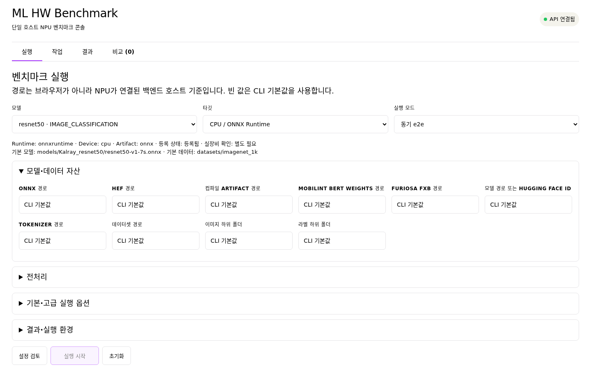

# 03. 벤치마크 실행

[목차](README.md) · [이전: NPU·모델·데이터셋 설정](02-configuration.md) · [다음: 결과 확인 및 해석](04-results.md)

## CLI: 소량 확인

선택한 장비에서 준비, Runtime load, 추론 호출이 끝나는지 먼저 확인한다.
다음은 CPU에서 ResNet50 한 step을 실행하는 예시다. 모델과 ImageNet 데이터가
없으면 자동 준비가 시작될 수 있다. 이 실행의 정확도·처리량은 최종 결과로
사용하지 않는다.

```bash
cd /path/to/ML-HW-Benchmark-Framework/framework
source .venv/bin/activate
python src/main.py --model resnet50 --target cpu \
  --inference-mode e2e --warmup 0 --max-steps 1 \
  --results-path results/user-guide-smoke.csv
```

## 실행 모드 선택

| 목적 | CLI 옵션 | 확인할 결과 |
|---|---|---|
| 순차 실행과 기본 동작 확인 | `--inference-mode e2e` | 명령 종료 상태와 저장된 CSV 행 |
| 품질 평가와 비동기 완료 처리량 확인 | `--inference-mode async_queue --async-pass quality-and-runtime` | 품질·성능 패스와 완료·실패 수 |
| 품질 평가를 생략한 런타임 부하 진단 | `--inference-mode async_queue --async-pass runtime-only` | 성능 패스만 확인. `quality_status=skipped`가 예상 상태 |

`e2e`가 기본 모드이며, `quality-and-runtime`은 비동기 기본 패스다.
`async_queue`는 해당 target이 지원할 때 사용한다. 모드별 시간 측정 구간은
[측정 계약](../../framework/docs/measurement-contract.md)에 있다.

## CLI: 본 실행

모델·NPU 조합은 [설정 문서](02-configuration.md)에 연결된 실행 명세의
모델·데이터·artifact 설정과 표본 수, warmup 조건을 따른다. 다음 명령은 준비된
CPU 프로필의 전체 데이터를 실행하는 기본 예시다.

```bash
python src/main.py --model resnet50 --target cpu \
  --inference-mode e2e --warmup 2 \
  --results-path results/resnet50-cpu-e2e.csv
```

동기 `e2e`의 `--max-steps`는 반복 step 상한이다. `async_queue`에서는
`--max-steps` 대신 `--max-samples`를 사용한다.
worker 수는 target이 지원하는 범위에서 정한다. 소량 확인과 본 실행의
CSV 경로를 분리한다. 비동기 부하 옵션과 trace는
[비동기 추론 큐 가이드](../../framework/docs/async-inference-queue.md)를 따른다.

## 웹 화면

[설치 절차](01-installation.md)를 마친 뒤, NPU가 연결된 **한 호스트**에서
백엔드를 worker 1개로 실행한다. 벤더별 Python 환경은 서버의
`WEB_RUNNERS_FILE`에 등록한다. 예시는
[`runner_profiles.example.json`](../../backend/config/runner_profiles.example.json)에 있다.

```bash
cd /path/to/ML-HW-Benchmark-Framework/backend
../framework/.venv/bin/python -m uvicorn app.main:app --host 127.0.0.1 --port 8000 --workers 1
```

```bash
cd /path/to/ML-HW-Benchmark-Framework/frontend
npm ci
npm run dev
```

`http://localhost:5173`에서 다음 순서로 실행한다.



위 화면은 ResNet50과 CPU를 선택한 사용 예시다. 화면을 캡처할 때 추론은 실행하지 않았다.

1. **실행**에서 모델·target과 필요한 자산 경로를 선택한다. 경로는 브라우저
   컴퓨터가 아닌 백엔드 호스트 기준이다. 빈 입력은 CLI 기본값을 유지한다.
2. `e2e` 또는 `async_queue`를 고른다. 비동기는 `quality-and-runtime`과
   `runtime-only`, `offline`과 `server_like` 시나리오, worker·queue·표본 수·
   timeout·trace 옵션을 지정할 수 있다. `server_like`에는 target QPS가 필요하다.
3. **설정 검토**에서 Python 환경, 결과 CSV, 최종 CLI 명령, 자산 경로 오류를
   확인한다. 검토에서 오류가 없으면 **실행 시작** 버튼이 활성화된다.
   장치·SDK·품질의 실제 검증은 실행 결과로 확인한다.
4. **실행 시작**을 누르고 **작업**에서 `queued`/`running`/종료 상태와 로그를
   확인한다. 필요하면 **중단**한다. `RUN_ID_RESERVED`와 `RUN_ID`, CSV 행
   존재 여부는 별도로 표시된다.

실행 시작 후 창을 새로고침해도 작업 목록을 다시 조회할 수 있다. 별도 CLI
실행으로 만든 CSV는 결과 화면에서 경로를 등록한다. 허용 결과 root는
`WEB_RESULTS_ROOTS`, 자산 root는 `WEB_ASSET_ROOTS`로 설정한다.
웹 설정은 [프론트엔드 README](../../frontend/README.md)를 참고한다.

실행이 끝나면 [결과 확인 및 해석](04-results.md)으로 이동한다.
