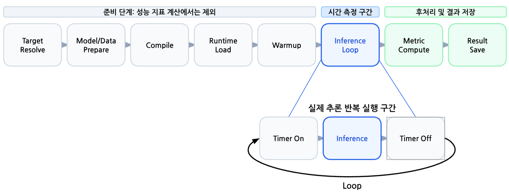

# 측정 계약

이 문서는 벤치마크 결과의 **측정 경계와 해석 방법**을 정의한다. 어떤 모델과 보드의
실행 결과가 있는지는 별도 문서에서 다룬다. 실행 모드 이름, 결과 지표 이름, 실제
시간 측정 구간을 구분해서 읽는다.

## 1. 실행 단계와 시간 측정 구간

그림은 동기 정적 모델의 준비·반복 실행·저장 **단계**를 개략적으로 보여준다.
아래의 `Timer On → Inference → Timer Off`는 각 Runtime 호출을 재는 위치에
해당한다. 그림의 `Metric Compute`는 최종 통계 계산을 뜻하며, sample별
decoder·evaluator 처리는 반복 중에도 수행된다. 파란색 `Inference Loop` 전체
wall time을 그대로 저장한다는 뜻은 아니다.

Target resolve, 모델·데이터 준비, 컴파일, runtime load, warmup은 성능 측정 전
준비 단계다. 최종 지표 계산과 파일 저장은 추론 후에 수행한다. 그림의 파란색
`Inference Loop`는 반복 실행 **단계**를 가리킨다. 그 안에서 어떤 시간을 재는지는
모드와 지표에 따라 달라진다.

| 구분 | 현재 코드가 시간을 재는 경계 | 결과 해석 |
|---|---|---|
| 동기 `e2e` | 정적 모델은 각 `runtime.run()` 호출 전후를 재고, LLM은 `generate()`가 반환한 생성 시간을 사용한다. | `Average Latency (ms)`와 `P99 Latency (ms)`는 주로 Runtime 호출의 batch별 기록이다. 데이터 로딩·전처리와 decoder·evaluator의 전체 wall time이 아니다. |
| `async_queue`, schema v2 | 첫 요청의 `issued`부터 producer 종료와 마지막 성공 Runtime 반환 중 늦은 시점까지 잰다. | `async_runtime_completed_samples_per_sec`는 이 구간에 반환된 성공 sample 수를 나눈 **완료 처리량**이다. |
| System E2E | 각 sample의 입력 준비부터 추론과 출력 처리까지 공통 경계를 별도로 계측해야 한다. | 현재 동기 `e2e`의 Runtime 지연시간을 System E2E 지연시간으로 바꾸어 부르지 않는다. 별도 계측 결과가 없으면 `미측정`으로 적는다. |

`e2e`는 순차 실행 모드의 이름이다. `InferenceEngine.run_e2e()`는 loader,
Runtime, decoder·evaluator를 순서대로 실행하지만, 저장되는 지연시간은 그 전체
루프의 경과 시간이 아니다. Runtime 호출에도 벤더 SDK의 host 처리나 반환 전 출력
복사가 포함될 수 있으므로 이를 순수 NPU 코어 시간이라고 부르지 않는다.
System E2E의 입력 준비는 사전 모델·데이터 다운로드가 아니라 측정 대상 sample의
load·전처리를 뜻한다.
구현 위치는 [RuntimeExecutor](../src/core/runtime_executor.py),
[InferenceEngine](../src/core/inference_engine.py),
[async metrics](../src/core/async_inference/metrics.py)다.

## 2. 성능 지표를 읽는 방법

- **동기 지연시간:** `Average Latency (ms)`와 `P99 Latency (ms)`는 evaluator가
  전달받은 Runtime timing 기록의 통계다. batch 단위 기록이므로 batch 크기와
  해당 evaluator의 계산식을 함께 확인한다. `Samples/s` 또는 `FPS`도 evaluator별
  계산식이 달라, 같은 이름만으로 System E2E 처리량이라고 해석하지 않는다.
- **비동기 완료 처리량:** `async_metric_schema_version=2` 및
  `async_measurement_boundary=framework_runtime_call_return`을 먼저 확인한다.
  `async_runtime_completed_samples_per_sec = async_runtime_completed_samples /
  async_runtime_measurement_duration_sec`다. 입력 공급, queue 대기, worker 준비가
  처리량을 제한할 수 있다. decoder·evaluator와 결과 저장 시간은 이 공식 분모에서
  제외된다. schema v1의 처리량이나 동기 `Samples/s`와 직접 합쳐 비교하지 않는다.
- **비동기 요청 지연:** `async_runtime_ready_latency_*`는 요청 발행부터 Runtime
  반환까지이며 queue 대기가 포함된다. `async_service_time_*`는 worker의
  `executor.execute()` 구간이다. 둘 다 순수 NPU 코어 시간은 아니다.
  `async_e2e_latency_*`에는 후속 완료 처리까지 포함된다.
- **LLM:** 전체 생성 시간, TTFT, TPOT, 생성 token 처리율을 구분한다. TTFT·TPOT는
  실제 기록의 `timing_source`를 확인하고, 제공되지 않은 값은 추정하지 않는다.
  서로 다른 실행 모드에서 얻은 값을 한 행에 보고한다면 지표별 모드와 worker 수를
  명시한다.

async의 세부 timestamp, 수식, trace 판독은 [비동기 추론 큐 측정 가이드](../../docs/async-inference-queue.md)를 따른다.

## 3. 유효성·정확도·비교 가능성

기본 `async_queue`는 정확도 패스와 성능 패스를 순서대로 실행한다.
`--async-pass runtime-only`는 정확도 패스를 생략한다. 다음 상태는 서로 다른
판정이다.

| 확인 항목 | 뜻 |
|---|---|
| `async_run_status=valid` | 요청 제출·완료·오류 등 lifecycle 조건을 만족했다. 입력 공급이 충분했거나 NPU가 포화됐다는 뜻은 아니다. |
| `quality_status=passed` | evaluator가 오류 없이 sample을 집계하고 성능 패스와 표본 수를 대조했다. Top-1·AP 등의 목표 임계값 통과를 뜻하지 않는다. |
| `comparison_eligible=true` | 코드의 상태 검사를 통과해 품질을 동반한 비교 후보가 됐다. 모델·데이터·artifact·측정 경계의 동일성은 별도로 확인한다. |
| `quality_status=skipped` 또는 `unavailable` | 정확도 검증을 건너뛰었거나 evaluator가 없다. 성능 진단값으로만 사용한다. |

공식 비교에는 위 상태 외에 실제 정확도 수치, 처리 sample 수, Runtime 성공 수와
terminal 완료 수의 일치, 실패·거절·timeout·미완료 수를 확인한다. 낮은 처리량을
NPU 성능 저하로 해석하기 전에 producer load, queue wait, worker utilization,
오류를 확인한다. worker 수만으로 실제 NPU 병렬 실행을 주장하지 않는다.

## 4. 결과에 함께 적을 조건

수치 하나만 제시하지 않고 모델·데이터셋·표본 수, artifact, 실행 모드와 metric
schema, batch·worker·queue, warmup, 입력 사전 적재 여부, Runtime·코드 버전,
지표 이름과 단위를 함께 적는다. 비교하려는 결과는 같은 의미의 측정 경계와
동일한 품질 기준을 만족해야 한다. 사전 적재 시간을 제외했어도 mmap page fault나
입력 공급 부하는 남을 수 있다.

전력·에너지는 수집 장치와 측정 지점(chip, board/card, system), 샘플 시간축과
추론 구간의 정렬을 확인한 뒤에만 보고한다. 서로 다른 측정 지점의 W·J를 같은
비교 열에 놓지 않는다. 확인되지 않은 값은 0이나 추정치 대신 `미수집` 또는
`미산출`로 기록한다. 공통 System E2E 및 전력 비교의 조건은
[교차 NPU 모델 검증](cross-npu-model-validation.md)에 정리되어 있다.
